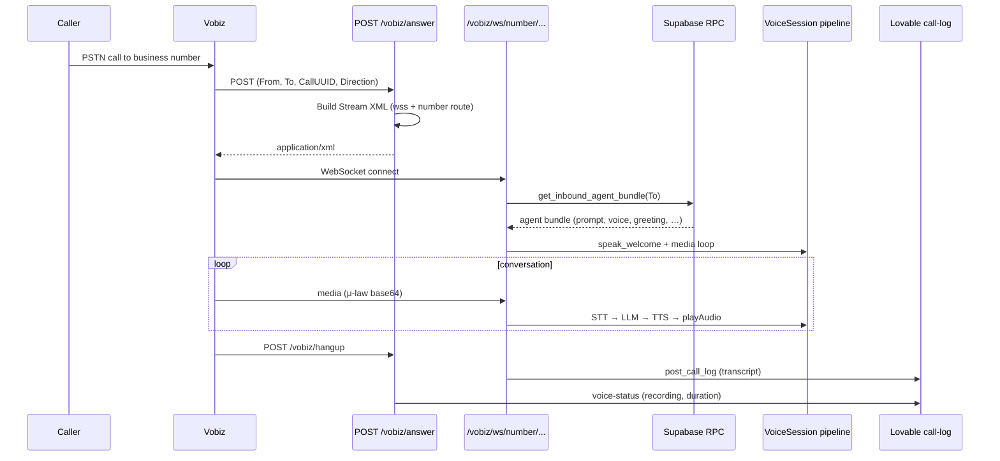

# Vobiz + MoontechPro Voice Agent Integration

This document describes how to connect **Vobiz** telephony to the existing **Agent-Stream-echobot** stack (Exotel-style SaaS: Supabase agents, Lovable control plane, compound voice pipeline).

**Reference implementation:** `~/Desktop/client_docs/moontechpro/vobiz-ai-agent` (Vobiz protocol + μ-law audio, single-tenant `.env` only).

**Production target:** This repo (`ai_server.py` + `app/`) with a **Vobiz telephony adapter** layered on the same agent resolution, session lifecycle, and call logging as Exotel.

### Implemented in this repo (voice server)

| Component | Location |
|-----------|----------|
| Vobiz WebSocket `/ws` (configurable `VOBIZ_WS_PATH`) | `app/telephony/vobiz/ws_handler.py` — routed from `ai_server.py` |
| μ-law ↔ PCM | `app/audio_utils.py` |
| Compound pipeline + Vobiz `playAudio` | `app/telephony/vobiz/session.py` |
| Optional HTTP answer/hangup | `app/telephony/vobiz/http.py` on `WEBHOOK_PORT` (`/vobiz/answer`, `/vobiz/hangup`) |

**Moontech Stream URL (confirmed with Lovable):** `wss://voice.moontechpro.com/ws?token=...` or `.../ws/number/{digits}` or `?number=...`

**Direct inbound (client Vobiz number → voice server):**

1. Vobiz Application **Answer URL** → `https://voice.moontechpro.com/vobiz/answer` (proxy to `WEBHOOK_PORT`)
2. **Hangup URL** → `https://voice.moontechpro.com/vobiz/hangup`
3. Answer returns XML → `wss://voice.moontechpro.com/ws/number/{To}` → Supabase `get_inbound_agent_bundle(To)`
4. Call rows: `app/call_records.py` upserts `ai_calls` with `provider=vobiz`, `user_id`, `agent_id`, `phone_number_id`, transcript, recording

---

## Table of contents

1. [Goals](#1-goals)
2. [Current system (Exotel) recap](#2-current-system-exotel-recap)
3. [Vobiz vs Exotel (technical)](#3-vobiz-vs-exotel-technical)
4. [Target architecture](#4-target-architecture)
5. [Vobiz Console: Voice Application (inbound)](#5-vobiz-console-voice-application-inbound)
6. [Inbound call flow](#6-inbound-call-flow)
7. [Outbound call flow](#7-outbound-call-flow)
8. [Supabase & Moontech (Lovable) requirements](#8-supabase--moontech-lovable-requirements)
9. [Call end: transcript, recording, CRM](#9-call-end-transcript-recording-crm)
10. [Environment variables](#10-environment-variables)
11. [Deployment & nginx](#11-deployment--nginx)
12. [Implementation checklist (voice server)](#12-implementation-checklist-voice-server)
13. [Implementation checklist (Lovable)](#13-implementation-checklist-lovable)
14. [Testing & troubleshooting](#14-testing--troubleshooting)
15. [Rollback & coexistence with Exotel](#15-rollback--coexistence-with-exotel)

---

## 1. Goals

| Goal | Detail |
|------|--------|
| **Same SaaS agent model** | `ai_agents` fields unchanged: `system_prompt`, `voice`, `speed`, `tone`, `greeting_*`, `voicebot_token`, etc. |
| **Inbound by number** | Caller dials a Vobiz number → agent resolved via Supabase `get_inbound_agent_bundle(To)`. |
| **Outbound by token** | Campaign / UI mints `voicebot_call_tokens` → WSS URL carries `token` → agent + optional script overrides. |
| **Call history** | Transcript + metadata to Lovable `call-log`; recording + outcome via hangup/status → `ai_calls` in Supabase. |
| **Low latency** | Reuse **compound pipeline** (`STREAMING_PIPELINE=true`) where possible; Vobiz playback uses **μ-law 8 kHz** (see [§3](#3-vobiz-vs-exotel-technical)). |

---

## 2. Current system (Exotel) recap

```
Caller ⇄ Exotel ⇄ wss://VOICE_SERVER/...  (Voicebot Applet)
                      │
                      ├─ WSS route: ?token=...  OR  .../number/{exophone}
                      ├─ agent_setup → Supabase (or cache) → per-call config overrides
                      ├─ VoiceSession / compound pipeline (STT → OpenAI → TTS)
                      └─ on stop/close → POST LOVABLE_APP_URL/api/public/voicebot/call-log

Exotel Status Callback → http://VOICE_SERVER:WEBHOOK_PORT/exotel/status
                      → relay → Lovable voice-status (RecordingUrl, CallDuration, …)
```

Key files today:

| File | Role |
|------|------|
| `ai_server.py` | Exotel WebSocket server, session lifecycle, call-log payload |
| `app/agent_setup.py` | Prefetch / load agent bundle on connect |
| `app/supabase_agent_provider.py` | Inbound RPC, outbound token tables |
| `app/lovable_client.py` | Call-log POST, Exotel webhook relay |
| `app/webhook_server.py` | HTTP `:WEBHOOK_PORT` — Exotel status, prewarm |
| `app/voice_session.py` | Turn-taking + streaming compound pipeline |

Default ports (`docker-compose.yml`):

| Port | Service |
|------|---------|
| `8002` (or `PORT`) | Exotel WSS |
| `8081` (or `WEBHOOK_PORT`) | Webhook relay |
| `5001` | Dashboard |

---

## 3. Vobiz vs Exotel (technical)

| Aspect | Exotel (this repo today) | Vobiz (to integrate) |
|--------|--------------------------|----------------------|
| Media codec on wire | PCM **slin** 16-bit LE @ 8 kHz | **μ-law** @ 8 kHz |
| WebSocket events (in) | `connected`, `start`, `media`, `clear`, `stop`, … | `start`, `media`, `playedStream`, `clearedAudio`, … |
| WebSocket events (out) | `media` (base64 PCM) | `playAudio`, `checkpoint`, `clearAudio`, `stop` |
| Answer hook | Often **Lovable** TwiML (`voice-inbound`) | **Vobiz Application** `answer_url` → **XML** `<Stream>` |
| Call identity | `call_sid`, `stream_sid` | `callId`, `streamId` (see Vobiz stream docs) |
| Outbound trigger | Exotel Flow / campaign | Vobiz REST `POST .../Account/{id}/Call/` |

**Audio implication:** Pre-cached greeting in Supabase is stored as **PCM L16 @ 8 kHz**. For Vobiz you must either:

- transcode PCM → μ-law at playback time, or  
- store a separate `greeting_audio_mulaw` (optional future column), or  
- skip cached PCM and use live TTS with `output_format=ulaw_8000` (ElevenLabs).

**Pipeline implication:** Compound pipeline TTS today targets Exotel PCM. Vobiz adapter should use an **μ-law output path** (as in `vobiz-ai-agent/app/tts.py`) or convert outbound frames before `playAudio`.

---

## 4. Target architecture

```
                    ┌──────────────────────────────┐
                    │ MoontechPro (Lovable UI)      │
                    │ Supabase: agents, numbers,    │
                    │           ai_calls, tokens      │
                    └───────────────┬────────────────┘
                                    │
          call-log POST             │  voice-status (recording)
          agent reads (Supabase)    │
                                    ▼
┌───────────────────────────────────────────────────────────────┐
│ Voice server (Agent-Stream-echobot + Vobiz adapter)            │
│                                                                 │
│  Exotel:  ws://HOST:PORT        (existing ai_server.py)        │
│  Vobiz:   POST /vobiz/answer    → XML + wss URL                │
│           WS   /vobiz/ws/...    → VobizStream + VoiceSession   │
│           POST /vobiz/hangup    → relay → Lovable voice-status │
│                                                                 │
│  Shared: agent_setup, lovable_client, supabase_agent_provider, │
│          voice pipeline (compound / openai_realtime)           │
└───────────────────────────────────────────────────────────────┘
          ▲                                    ▲
          │                                    │
     Exotel WSS                          Vobiz PSTN/SIP
```

Two inbound patterns (pick one per number):

| Pattern | Vobiz Primary answer URL | Agent resolution |
|---------|--------------------------|------------------|
| **A – Direct server (recommended for “straight to VPS”)** | `https://voice.example.com/vobiz/answer` | WSS path `.../number/{To}` → Supabase RPC |
| **B – Lovable first (full SaaS parity with Exotel)** | `https://www.moontechpro.com/api/public/hooks/vobiz-inbound?...` | Lovable mints token → WSS `?token=` |

This doc assumes **Pattern A** for the Vobiz Application form unless you need channel reservation minted before media (then use **B**).

---

## 5. Vobiz Console: Voice Application (inbound)

In **Voice → Applications → Create application**:

| Field | Recommended value | Notes |
|-------|-------------------|--------|
| **Application name** | e.g. `Moontech-AI-Inbound` | Label only |
| **Primary answer URL** | `https://{PUBLIC_HOST}/vobiz/answer` | **POST**. Must return valid **XML** with `<Stream>`. |
| **Hangup URL** | `https://{PUBLIC_HOST}/vobiz/hangup` | **POST**. Call ended → recording URL, duration, status. |
| **Fallback answer URL** | Optional backup URL | Used if primary fails / times out |
| **Default endpoint app** | ON | New endpoints can auto-link to this app |
| **Public URI** | Usually OFF | For PSTN numbers attached to the app |

`{PUBLIC_HOST}` = your TLS hostname **without** `https://` (e.g. `voice.moontechpro.com`).

### Attach a phone number

1. **Setup → Numbers** — purchase / verify number (inbound requires verified account; trial numbers are often outbound-only).
2. Link number to this application (API example from Vobiz docs):

```bash
curl -X POST "https://api.vobiz.ai/api/v1/Account/$VOBIZ_AUTH_ID/numbers/%2B91XXXXXXXXXX/application" \
  -H "X-Auth-ID: $VOBIZ_AUTH_ID" \
  -H "X-Auth-Token: $VOBIZ_AUTH_TOKEN" \
  -H "Content-Type: application/json" \
  -d '{"application_id":"<application_id>"}'
```

### Example answer response (dynamic per call)

Your `/vobiz/answer` handler reads `To`, `From`, `CallUUID` from the POST body/query, normalizes `To`, and returns:

```xml
<?xml version="1.0" encoding="UTF-8"?>
<Response>
  <Stream bidirectional="true" keepCallAlive="true"
          contentType="audio/x-mulaw;rate=8000"
          statusCallbackUrl="https://{PUBLIC_HOST}/vobiz/stream-status"
          statusCallbackMethod="POST">
    wss://{PUBLIC_HOST}/vobiz/ws/number/{normalized_to}
  </Stream>
</Response>
```

Use the same **number normalization** as Exotel WSS (`app/lovable_client.normalize_phone_number` — last 10 digits for India).

Alternative WSS routes (equivalent once implemented):

- `wss://{PUBLIC_HOST}/vobiz/ws?token={minted_token}` — outbound / Lovable-minted inbound  
- `wss://{PUBLIC_HOST}/vobiz/ws/voicebot/number/{digits}` — mirror Exotel path style  

---

## 6. Inbound call flow



**Server steps (mirror Exotel `ai_server.py`):**

1. **WSS connect** — set `wss_route_kind=number`, `wss_route_value=To`; start `start_agent_prefetch`.
2. **`start` event** — await agent bundle; `on_agent_ready()`; `speak_welcome()`.
3. **`media` events** — forward audio into pipeline (with echo guard / barge-in per `.env`).
4. **WS close / hangup** — `_finalize_call_session` → `post_call_log` once.

---

## 7. Outbound call flow

1. **Moontech UI / Lovable** creates row in `voicebot_call_tokens` (`agent_id`, `expires_at`, optional `overrides.script`, `customer_name`).
2. **Dial API** (platform or Lovable edge function) calls Vobiz:

```http
POST https://api.vobiz.ai/api/v1/Account/{VOBIZ_AUTH_ID}/Call/
X-Auth-ID: ...
X-Auth-Token: ...
Content-Type: application/json

{
  "from": "+91XXXXXXXXXX",
  "to": "+919YYYYYYYYY",
  "answer_url": "https://{PUBLIC_HOST}/vobiz/answer?token={TOKEN}",
  "answer_method": "POST",
  "hangup_url": "https://{PUBLIC_HOST}/vobiz/hangup",
  "hangup_method": "POST"
}
```

3. When callee answers, Vobiz hits `answer_url` → XML with  
   `wss://{PUBLIC_HOST}/vobiz/ws?token={TOKEN}` (or path segment token).
4. Server resolves agent via `voicebot_call_tokens` + `ai_agents` (existing `fetch_agent_payload_by_token`).
5. Campaign script merged into `system_prompt` (existing `supabase_agent_provider` helpers).

Protect platform-initiated dial endpoints with a secret (`CALL_API_KEY` pattern in `vobiz-ai-agent`).

---

## 8. Supabase & Moontech (Lovable) requirements

### Tables (confirm or migrate)

**`ai_agents`** — no schema change for Vobiz. Voice server reads:

`system_prompt`, `voice`, `speed`, `tone`, `default_language`, `greeting_message`, `greeting_audio_*`, `voicebot_token`, `status`, …

**`phone_numbers`** — one row per inbound Vobiz DID:

| Column | Example |
|--------|---------|
| `e164_number` | `+9198…` / formats Vobiz sends in `To` |
| `provider` | `vobiz` |
| `agent_id` | FK → `ai_agents.id` |
| `vobiz_application_id` | optional, for ops |
| `status` | `active` |

**`voicebot_call_tokens`** — outbound / one-off:

| Column | Purpose |
|--------|---------|
| `token` | WSS query or answer_url param |
| `agent_id` | Agent to run |
| `overrides` | JSON: `script`, `customer_name`, … |
| `expires_at` | Reject expired tokens |
| `provider` | optional: `vobiz` |

**`ai_calls`** — post-call record:

| Column | Source |
|--------|--------|
| `call_sid` | Vobiz `CallUUID` / call id |
| `provider` | `vobiz` |
| `direction` | `inbound` / `outbound` |
| `from_number`, `to_number` | Webhooks + WSS `start` |
| `transcript` | Voice server `call-log` JSON |
| `recording_url` | Hangup / Vobiz recordings + status hook |
| `duration_seconds`, `outcome` | Hangup / status |
| `agent_id`, `user_id` | Resolved agent |

**RPC `get_inbound_agent_bundle(phone_number text)`**

Must return the same shape the voice server already maps in `app/supabase_agent_provider.py` (`agent_id`, `user_id`, `system_prompt`, `voice_id`, `first_message`, `speed`, `tone`, greeting audio fields, …). Match numbers by **last 10 digits** (India).

### Lovable HTTP APIs

| Endpoint | Purpose |
|----------|---------|
| `POST /api/public/voicebot/call-log` | Upsert transcript + call metadata (existing) |
| `POST /api/public/hooks/voice-status` | Update `recording_url`, outcome; release channel (extend for `provider=vobiz`) |
| `GET/POST /api/public/hooks/vobiz-inbound` | Optional Pattern B — XML answer + token mint |
| `GET/POST /api/public/hooks/vobiz-answer` | Optional — outbound leg with `?token=` |

Auth: `Authorization: Bearer LOVABLE_API_SECRET` on server-to-server posts.

---

## 9. Call end: transcript, recording, CRM

### Transcript (voice server)

On session finalize, `ai_server.py` builds payload and calls `lovable_client.post_call_log` (fire-and-forget):

```json
{
  "call_sid": "<vobiz CallUUID>",
  "user_id": "...",
  "agent_id": "...",
  "from_number": "...",
  "to_number": "...",
  "direction": "inbound",
  "duration_seconds": 120,
  "started_at": "2026-01-01T12:00:00Z",
  "ended_at": "2026-01-01T12:02:00Z",
  "transcript": [
    { "role": "user", "text": "...", "ts": 1735732800 },
    { "role": "agent", "text": "...", "ts": 1735732805 }
  ],
  "recording_url": "https://..."
}
```

Map Vobiz hangup fields to this shape in `/vobiz/hangup` before relaying to Lovable.

### Recording

- Enable recording in Vobiz (application / account settings — see Vobiz **Recordings** in console).
- Pass recording URL on hangup or status callback → Lovable **`voice-status`** → update `ai_calls.recording_url`.

### Idempotency

Use `call_sid` as unique key; hangup may arrive before or after WSS close — merge into one `ai_calls` row.

---

## 10. Environment variables

Add to `.env` (voice server) alongside existing keys:

```env
# --- Vobiz telephony ---
VOBIZ_AUTH_ID=MA_XXXXXXXX
VOBIZ_AUTH_TOKEN=...
VOBIZ_FROM_NUMBER=91XXXXXXXXXX          # default outbound CLI
PUBLIC_HOST=voice.moontechpro.com       # no scheme; used in Stream XML

# Optional: protect POST /vobiz/call (outbound trigger)
VOBIZ_CALL_API_KEY=long-random-secret

# Existing (required for SaaS)
SUPABASE_URL=...
SUPABASE_SERVICE_ROLE_KEY=...             # preferred on server
LOVABLE_APP_URL=https://www.moontechpro.com
LOVABLE_API_SECRET=...

# Voice pipeline (keep aligned with Exotel production)
VOICE_PIPELINE=compound
STREAMING_PIPELINE=true
```

Do **not** remove Exotel `PORT` / `WEBHOOK_PORT` — both providers can run on the same VM behind nginx with different paths.

---

## 11. Deployment & nginx

Example reverse proxy (single host):

| Public path | Backend |
|-------------|---------|
| `wss://voice.example.com/exotel/...` | `http://127.0.0.1:8002` (existing Exotel WSS) |
| `wss://voice.example.com/vobiz/ws` | Vobiz WS handler (same or separate process) |
| `https://voice.example.com/vobiz/answer` | HTTP app (FastAPI or extend `webhook_server`) |
| `https://voice.example.com/vobiz/hangup` | same |
| `http://voice.example.com:8081/exotel/status` | existing webhook relay |

Requirements:

- Valid TLS certificate (Vobiz requires **HTTPS** answer URL and **WSS** stream URL).
- WebSocket upgrade headers on `/vobiz/ws`.
- Server region close to India (Mumbai) for latency.

Reference nginx snippet: `vobiz-ai-agent/scripts/nginx-vobiz.conf.example`.

---

## 12. Implementation checklist (voice server)

Status as of this document: **Vobiz adapter is specified here; wire-up in this repo is follow-up work.** Use `vobiz-ai-agent` for protocol reference.

| Task | Reference | Notes |
|------|-----------|--------|
| `POST /vobiz/answer` | `vobiz-ai-agent/app/main.py`, `vobiz.py` `stream_xml` | Dynamic `To` → WSS number route |
| `POST /vobiz/hangup` | `vobiz-ai-agent/app/main.py` | Relay to `lovable_client.post_exotel_status` equivalent with Vobiz field map |
| `POST /vobiz/stream-status` | optional | Stream errors |
| WebSocket `/vobiz/ws` | `VobizStream`, `CallSession` | Replace demo STT/LLM with `VoicePipelineSession` |
| WSS routing | `ai_server._extract_wss_route` | Reuse `number` / `token` kinds |
| Agent load | `agent_setup.load_agent_bundle_into_session` | Unchanged |
| μ-law I/O | `vobiz-ai-agent/app/vobiz.py`, `tts.py` | TTS `ulaw_8000`; greeting PCM transcode |
| Outbound REST | `make_outbound_call` | Optional `/vobiz/call` for ops |
| Call log | `ai_server._build_call_log_payload` | Map `callId` → `call_sid` |
| Docker | `docker-compose.yml` | Expose Vobiz HTTP port or merge into one process |

---

## 13. Implementation checklist (Lovable)

- [ ] `phone_numbers.provider = 'vobiz'` + UI to map number → agent  
- [ ] RPC `get_inbound_agent_bundle` includes Vobiz numbers  
- [ ] `call-log` handler upserts `ai_calls` with transcript  
- [ ] `voice-status` accepts Vobiz form fields (`CallUUID`, recording URL, status)  
- [ ] (Optional) `vobiz-inbound` / `vobiz-answer` hooks for Pattern B  
- [ ] Outbound UI: mint token + trigger Vobiz `Call` API  
- [ ] Dashboard: show `provider` column on call history  

Copy-paste brief for Lovable is also embedded in §8 and in project chat history (`docs/VOBIZ_INTEGRATION.md` is the canonical spec).

---

## 14. Testing & troubleshooting

| Step | Action |
|------|--------|
| Local dev | ngrok / Cloudflare tunnel → set Vobiz app `answer_url` to tunnel HTTPS |
| Health | `GET /health` on Vobiz HTTP service |
| Inbound test | Call attached Vobiz number; logs should show `get_inbound_agent_bundle ok` |
| Agent missing | 404 from RPC → check `phone_numbers` row and `status=active` |
| No bot audio | ElevenLabs voice id / model; payload must be **μ-law** for `playAudio` |
| Garbled audio | Codec mismatch — do not send PCM slin on Vobiz stream |
| Immediate drop | XML must include `bidirectional="true"` and `keepCallAlive="true"` |
| No transcript | Check `LOVABLE_APP_URL` and call-log logs in `logs/ai_voice_agent.log` |
| No recording | Hangup relay + Vobiz recording enabled |

Offline protocol test pattern: `vobiz-ai-agent/tests/test_agent.py`.

---

## 15. Rollback & coexistence with Exotel

- **Exotel unchanged:** keep `PORT`, Exotel Flow, and Lovable `voice-inbound` as today.  
- **Vobiz only on new numbers** with `provider=vobiz` in `phone_numbers`.  
- **Disable Vobiz:** point Vobiz application answer URL to a static message XML or unlink numbers — no Exotel impact.  
- **Pipeline rollback:** `STREAMING_PIPELINE=false` affects both providers if they share `VoiceSession`.

---

## Related docs

- [STREAMING_PIPELINE.md](./STREAMING_PIPELINE.md) — compound latency pipeline  
- [../app/voice_pipeline/README.md](../app/voice_pipeline/README.md) — `VOICE_PIPELINE` providers  
- [../README.md](../README.md) — Exotel quick start  
- Vobiz: [Stream XML](https://vobiz.ai/docs/xml/stream), [Make call API](https://vobiz.ai/docs/call/make-call)

---

*Document version: 1.0 — integration spec for MoontechPro + Agent-Stream-echobot + Vobiz.*
